# Разработка aj-web

Подробная документация по веб-клиенту `ada-judge`: устройство, контракты с
бэкендом, команды сборки и грабли, на которые уже наступали.

Базовые вещи (установка, продакшен-сборка, стили) есть в
[README.md](../README.md) — здесь то, чего там нет.

## Содержание

- [Стек и версии](#стек-и-версии)
- [Команды](#команды)
- [Структура проекта](#структура-проекта)
- [Маршруты](#маршруты)
- [Состояние](#состояние)
- [API-слой](#api-слой)
- [Контракты с бэкендом, которые легко сломать](#контракты-с-бэкендом-которые-легко-сломать)
- [WebSocket](#websocket)
- [Уведомления](#уведомления)
- [Markdown](#markdown)
- [Темы и стили](#темы-и-стили)
- [Локализация](#локализация)
- [Грабли](#грабли)
- [Скриншоты](#скриншоты)

## Стек и версии

| Что | Версия | Где |
| --- | --- | --- |
| Dioxus | 0.7 | `Cargo.toml` |
| Tailwind CSS | v4 | `package.json` |
| daisyUI | v5 | `src/input.css` |
| `aj-models` | 1.0.0-alpha7 | `Cargo.toml` |

Модели данных не дублируются: `src/models/*` — тонкие реэкспорты из
`aj-models`. Правки полей делаются там и тянутся обновлением крейта.

## Команды

```bash
npm run build:css    # пересобрать public/tailwind.css (обязательно!)
dx build            # собрать wasm
dx serve            # дев-сервер с hot reload
```

Tailwind сканирует **Rust-исходники**, поэтому после смены любого класса
обязательны обе команды. `dx build` сам по себе лишь копирует уже собранный
`public/tailwind.css`.

Проверки перед коммитом:

```bash
cargo fmt --check
cargo clippy --all-targets
npm run build:css && dx build
```

## Структура проекта

```
src/
  main.rs        точка входа, монтирование
  lib.rs         маршруты, навбар, мобильный хедер, заголовки документов,
                 реакция на UserDeleted
  state.rs       GlobalState, localStorage (токен, язык, вкладка, язык посылок)
  alerts.rs      тосты и дедупликация
  i18n.rs        переводы и хелперы заголовков
  input.css      темы, компонентные классы
  api/           HTTP-слой: auth, contests, problems, users
  models/        реэкспорты aj-models
  pages/         по файлу на маршрут
  components/    переиспользуемые куски и ленты WS
  hooks/         пусто, место под будущее
```

## Маршруты

Объявлены в `src/lib.rs`:

| Путь | Страница |
| --- | --- |
| `/` | `welcome` |
| `/login` | `login` |
| `/register` | `register` |
| `/home` | `home` — контесты |
| `/problems` | `problems` — задачи |
| `/users` | `users` |
| `/contest/:contest_id` | `contest` — вкладки задачи/посылки/объявления/вопросы/таблица |
| `/account` | `account_profile` |
| `/user/:user_id` | `user_profile` |
| `/user/:user_id/private` | `user_private_profile` |

## Состояние

Глобальное состояние — `GlobalSignal<GlobalState>` (`state::STATE`): токен,
пользователь, язык, контесты, задачи контеста, посылки, посты, вопросы,
таблица лидеров, пользователи.

В localStorage (`state.rs`):

| Ключ | Смысл |
| --- | --- |
| `aj_web_token` | JWT |
| `aj_web_lang` | язык интерфейса (`ru`/`en`) |
| `aj_web_tab` | последняя открытая вкладка контеста |
| `aj_web_submit_lang` | язык посылок (индекс селекта) |

Всё, что должно пережить перезагрузку, лежит здесь, а не в `use_signal`.
Сигналы — только для состояния конкретного экрана.

## API-слой

`src/api/mod.rs` собирает клиент и общую обработку ответов:

- база зашивается в wasm на этапе сборки: `API_BASE=... dx build --release`,
  по умолчанию `https://aj-host.oneprog.org`;
- `auth_header` даёт `Bearer {token}`;
- `check` на не-2xx разбирает тело в `AdaJudgeError` и переводит его в
  человеческий текст через `models::errors::describe_error`.

Каждая функция возвращает `Result<T, String>`, где `Err` — уже готовая строка
для тоста.

## Контракты с бэкендом, которые легко сломать

### Создание задачи

Эндпоинт — **`POST /contests/{contest_id}/problems/new`**, за `require_admin`.
Эндпоинта `POST /problems/new` не существует.

Обязательны **оба** multipart-поля:

- `problem_archive` — байты архива;
- `problem_index` — **0-based** номер в контесте, JSON-числом (`"0"`).

Без `problem_index` сервер отвечает `BadRequest`. Отсюда правило: в UI номер
задаётся с единицы, а перед отправкой переводится через
`components::problem_number::problem_index_zero_based`.

### Обновление задачи

`PATCH /problems/{problem_id}/update` — multipart с теми же двумя полями.
Номер задаётся и при создании, и при обновлении: степпер стоит и в модалке
создания в контесте, и в админ-модалке задачи.

### Прочее

- `DELETE` для проблемы и пользователя требует тела `DeletionRequest`
  (логин, пароль, подтверждение) — это `send_json`, а не пустой запрос.
- Переупорядочивание задач **не поддерживается**: `create_problem` пишет
  `index` как есть, хвост не сдвигает. Вставка в середину даст дубликаты
  номеров. Изменение порядка возможно только повторной отправкой архива с
  другим `problem_index` — то есть фактически заменой задачи.

## WebSocket

Транспорт общий — `components/ws.rs`.

- Токен едет в query: `wss://host/contests/ws?token={JWT}` — браузерный
  `WebSocket` не умеет заголовки.
- Подписки учитываются в `WS_SUBSCRIBED` (множество ключей); повторный вызов
  с тем же ключом из рендера безопасен.
- Живые задачи подписок лежат в `OPEN_TASKS` с `AbortHandle` — отписка рвёт
  соединение сразу, а не «после следующего обрыва».
- Heartbeat: `__ping__` каждые 15 с (чаще типичных idle-таймаутов NAT).
- Ретрай: 2 с между попытками, пока подписка жива.

Реальные пути на сервере:

| Лента | Путь |
| --- | --- |
| Все контесты | `/contests/ws` |
| Один контест | `/contests/{id}/ws` |
| Все задачи | `/problems/ws` |
| Все пользователи | `/users/ws` |
| Свой профиль | `/users/me/ws` |
| Профиль по id | `/users/{id}/ws` |

Путей `/problems/my/ws` и `/contests/my/ws` **нет** — клиент на них не
подписывается, «мои» данные приходят из общих лент.

Обработчики: `contest_ws.rs`, `problems_ws.rs`, `users_ws.rs`. Набор событий
задаёт `aj-models` (`ContestsEvent`, `ProblemsEvent`, `UsersEvent`); неизвестное
событие молча игнорируется, чтобы новое в крейте не роняло ленту.

## Уведомления

Тосты — `alerts.rs`. Для задач и пользователей используется синий `Info`
(зелёный `Success` в этих областях убран намеренно).

Собственные изменения мьючатся, иначе событие-эхо дублировало бы тост:
`ws::mark_self_action("users" | "problems")` ставит метку перед запросом, а
обработчик ленты проверяет `ws::is_self_echo`. Окно — 3 секунды.

Метки времени считаются через `js_sys::Date::now()`, **не** через
`std::time::Instant`: на `wasm32-unknown-unknown` `Instant` не реализован и
паникует, а непойманная паника в wasm убивает инстанс — вкладка виснет.

Выход и удаление аккаунта вызывают `ws::unsubscribe_all_ws()`, которая чистит
ключи **и** рвёт живые сокеты через `AbortHandle`. Самостоятельной очистки
ключей мало: проверка подписки стоит снаружи `ws_loop`, поэтому без `abort`
соединения продолжают слать события уже неавторизованному пользователю.

## Markdown

`components/markdown.rs` (+ тесты `render_markdown`) поддерживает:

- сноски обоих видов (`[^1]` и `^[текст]`);
- definition lists;
- математику `$...$` и `$$...$$` через KaTeX;
- GitHub-admonitions `[!NOTE]`, `[!TIP]`, `[!IMPORTANT]`, `[!WARNING]`,
  `[!CAUTION]` — с иконками и переводом заголовков.

## Темы и стили

Чистый daisyUI, без сторонней библиотеки компонентов. Собственные темы
`violet` / `violet-dark` заданы в `src/input.css` (OKLCH); контраст пар текста
выше WCAG AA.

Классы — только утилиты плюс несколько глобальных правил в `src/input.css`.
Копирования стилей в рантайме нет.

## Локализация

`i18n::tr(&lang, "русский", "english")` — переключение языка кнопками в
навбаре, выбор хранится в `aj_web_lang`. Хелперы заголовков: `problem_title`,
`contest_title` — берут `name_en`, если язык английский и поле не пустое.

Номер задачи в интерфейсе **1-based** (`#12`), на проводе **0-based**. Это
разные числа в разных слоях, не путать.

## Грабли

Собрано то, что уже стоило времени.

### `dx fmt` портит rsx

Форматирование рушит `rsx!`: теряются скобки и `;`, дублируются строки,
ломаются строковые литералы внутри интерполяции. **Не использовать.**
Форматировать вручную и проверять `cargo fmt --check`.

### Паника `Instant` на wasm

См. [Уведомления](#уведомления). Для времени в браузере — `js_sys::Date::now()`.

### `cargo clippy --fix` удаляет helpers

Автофикс считает «неиспользуемым» то, что вызывается из rsx или через
`STATE`, и выносит наружу. После него — обязательно `git diff` и проверка
call sites.

### Карточки в списке задач схлопываются

Корень `ProblemCard` имеет `flex-1 min-h-0`: внутри `flex flex-col` с
ограниченной высотой карточка становится flex-элементом с `flex-basis: 0` и
сжимается до нуля, когда их много. Лечится обёрткой `shrink-0` — как в
`pages/problems.rs`.

### Собственные компоненты в `#[component]`

Атрибут `#[component]` **сам** генерирует `Props` и builder. Свой
`struct ...Props` с теми же именами даст десяток ошибок дублирования.

### Замыкания в rsx и `lang`

`onclick`/`onchange` — `FnMut`, поэтому `lang` нельзя уносить в `spawn`
напрямую: нужен `clone()` перед. В коде местами язык берётся заново через
`crate::state::language()` — так сделано в существующих компонентах.

### Файловые input-оверлеи

Кнопка выбора файла — это `<label class="btn ... relative overflow-hidden">` с
`<input type="file" class="absolute inset-0 opacity-0 cursor-pointer">`
внутри. Всё, что рисуется «рядом» с label, обязано быть **вне** его тегов,
иначе окажется внутри кнопки.

### CSS-селекторы против Dioxus

У поля логина нет атрибута `type`, его DOM-свойство — `text`. Селектор
`input[type="text"]` его не находит (важно для автотестов на Playwright).

## Скриншоты

Продакшен- сборки, снятые headless-Chromium. В `docs/screenshots/` — ключевые
страницы; полный набор (48 файлов: светлая/тёмная темы, десктоп 1440×900 и
мобильный 390×844) снимается скриптом через Playwright.

| Страница | Снимок |
| --- | --- |
| Welcome | 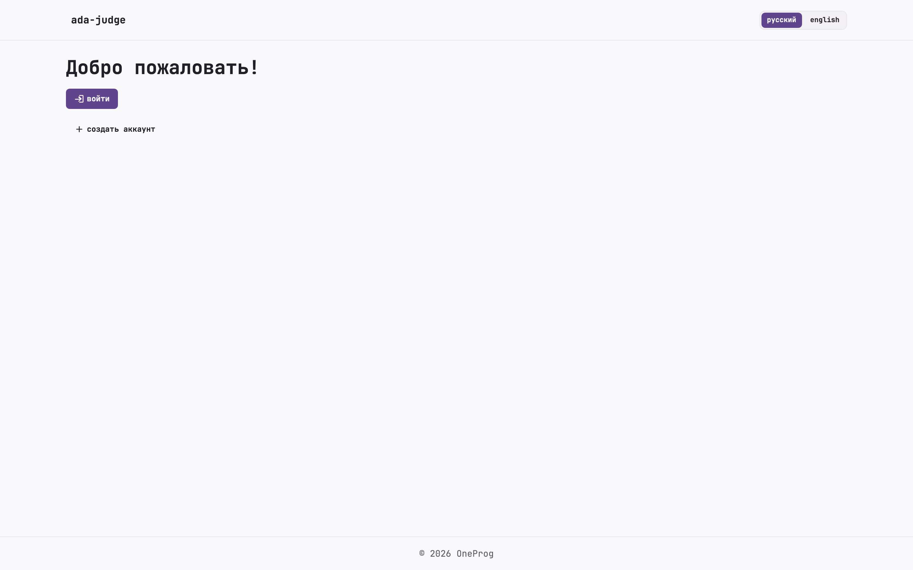 |
| Регистрация | 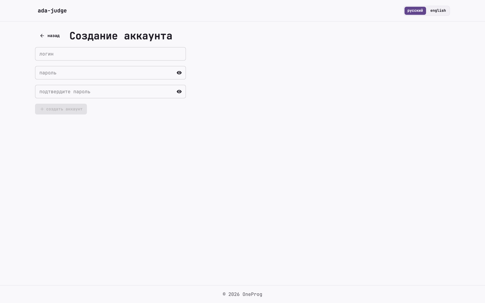 |
| Главная (контесты) | 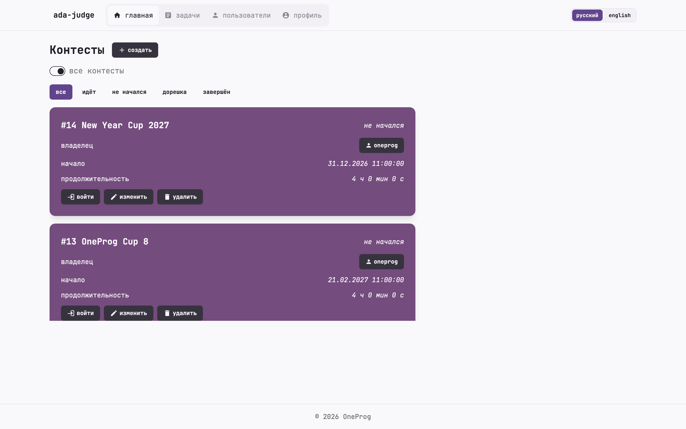 |
| Задачи, свои | 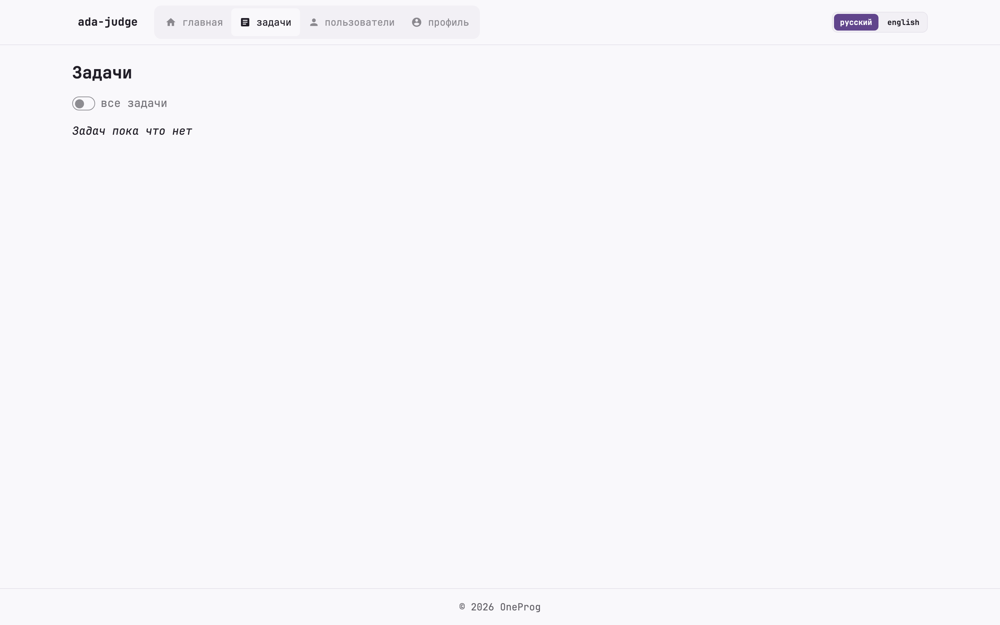 |
| Задачи, все | 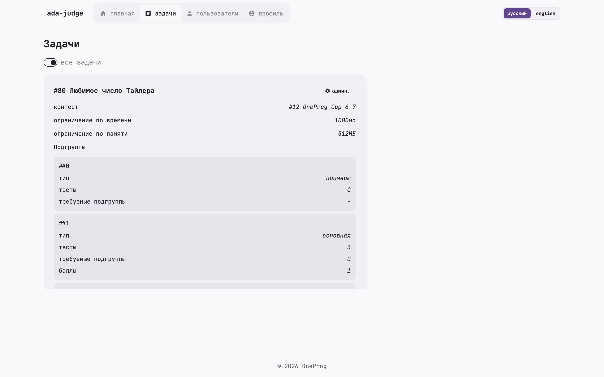 |
| Пользователи | 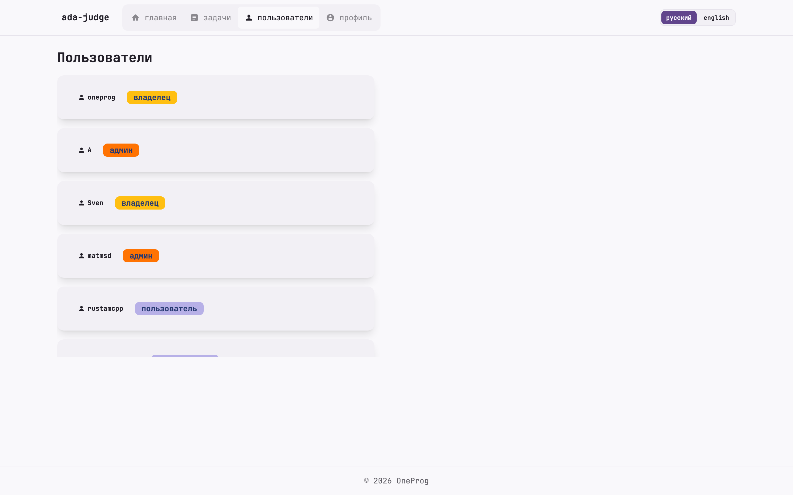 |
| Профиль | 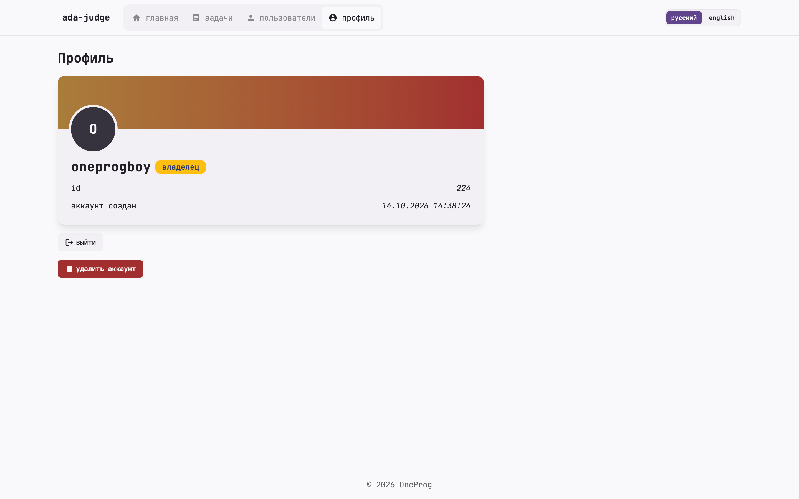 |
| Контест, задача | 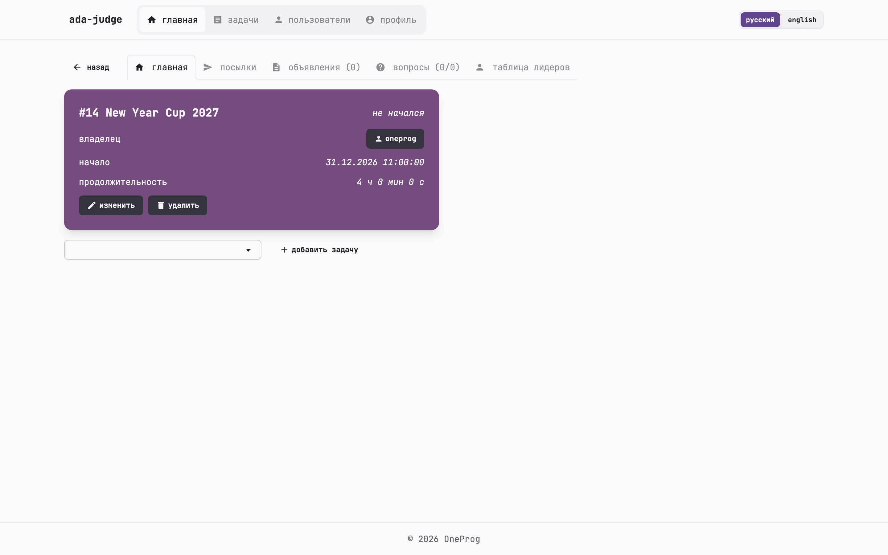 |
| Контест, посылки | 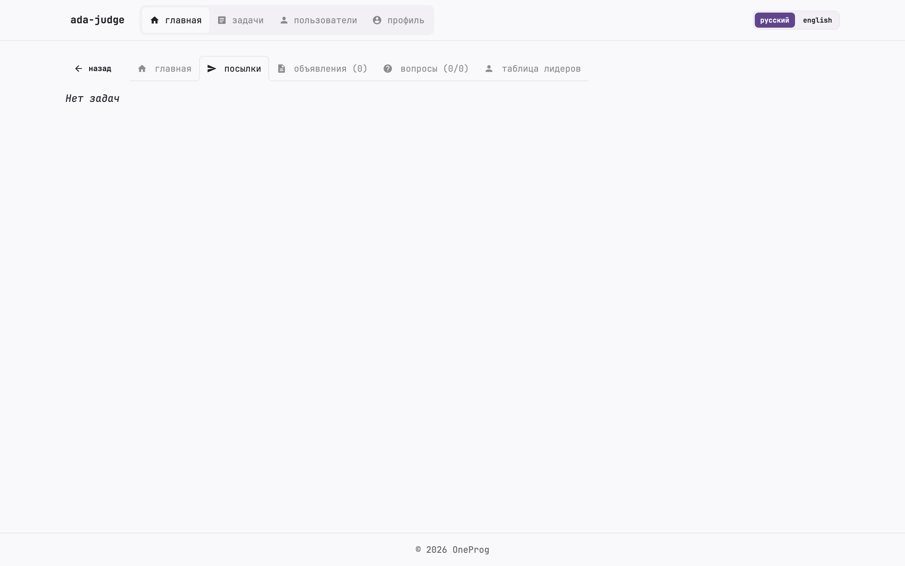 |
| Контест, объявления | 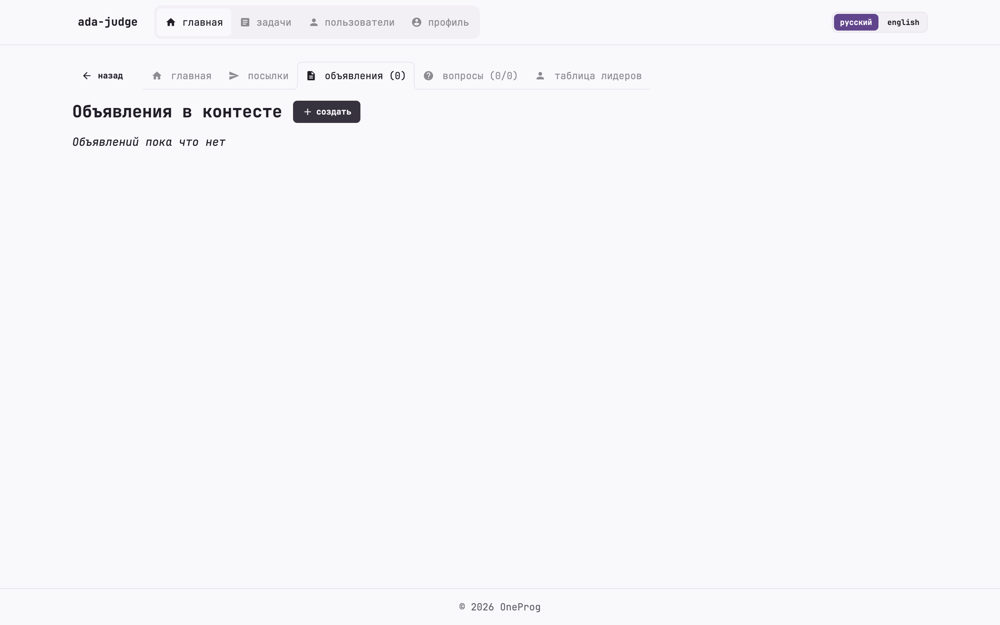 |
| Контест, вопросы | 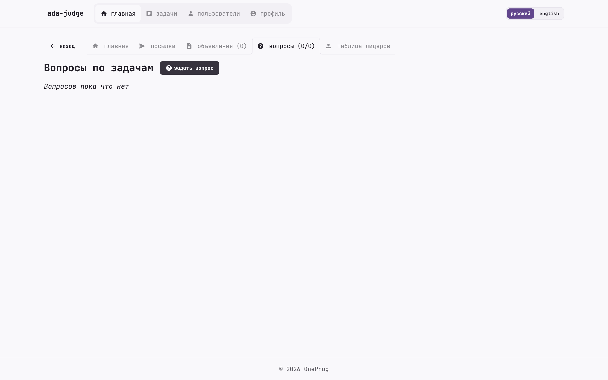 |
| Таблица лидеров | 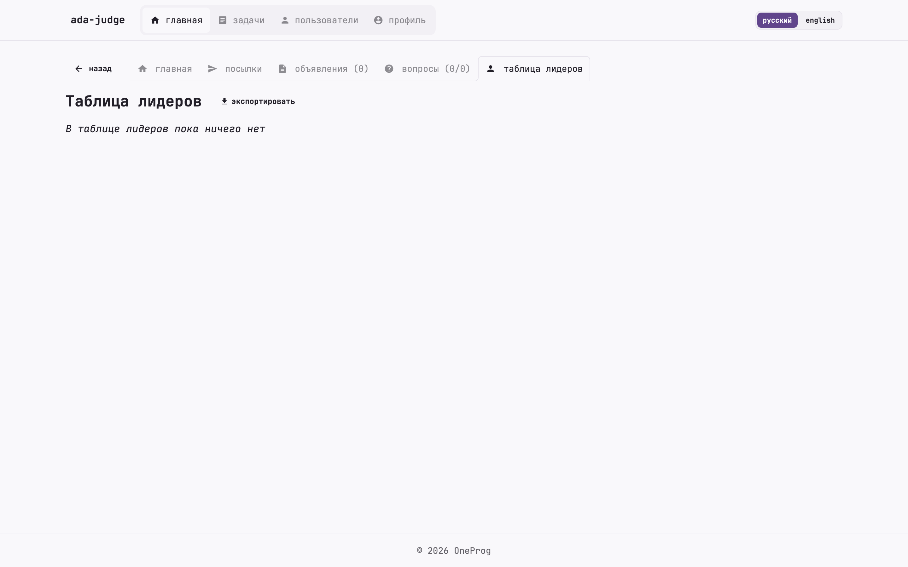 |
| Мобильная главная | 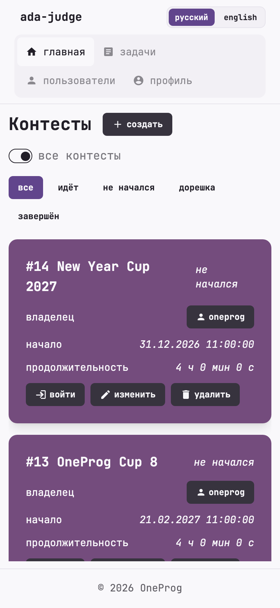 |
| Тёмная тема, контест | 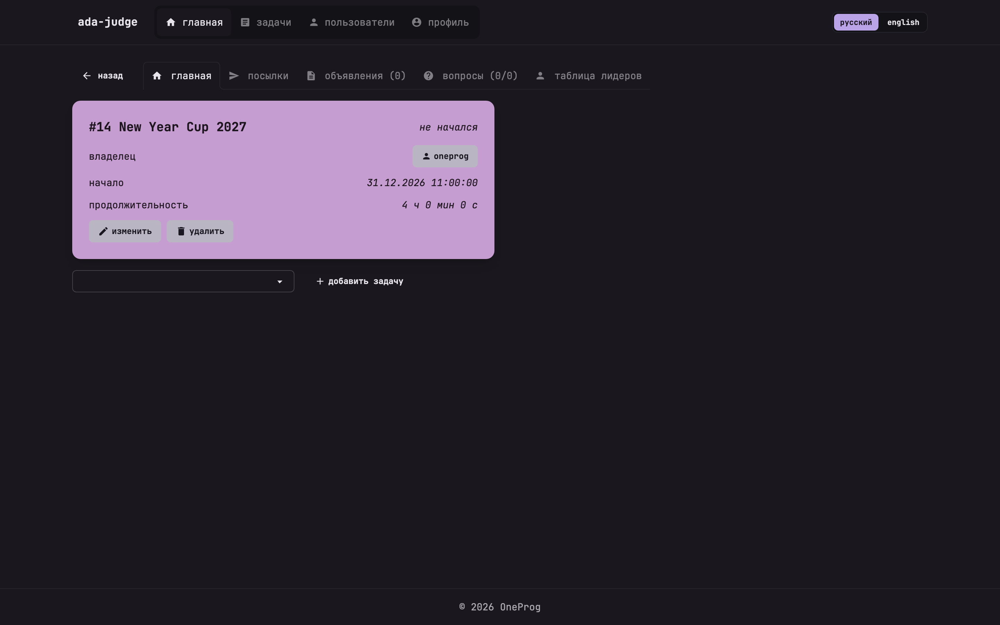 |